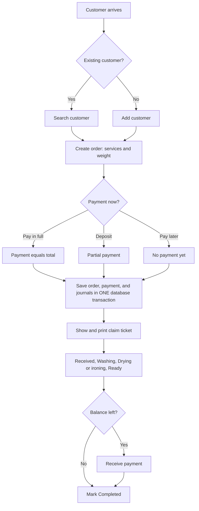
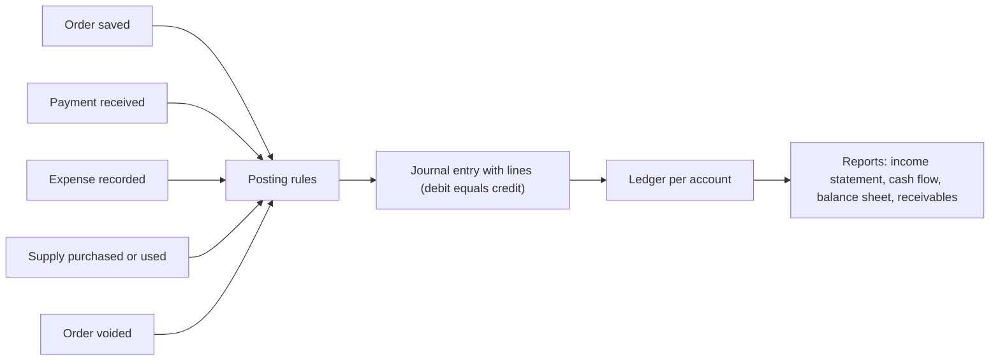
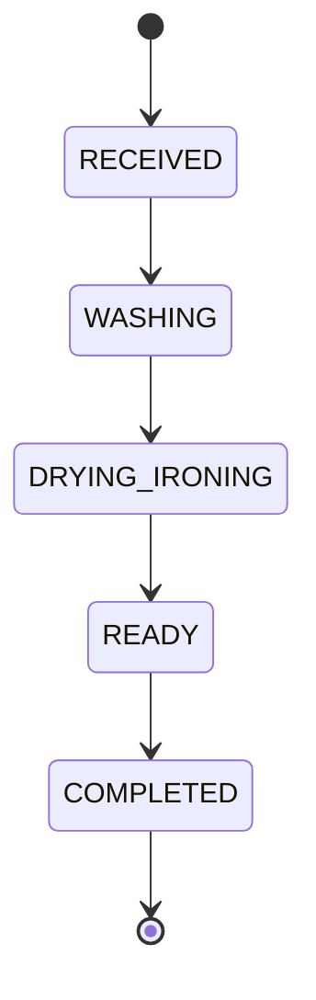
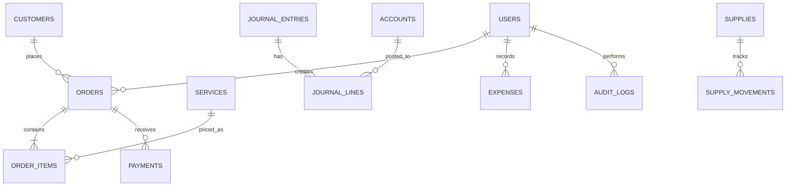

# PRD: LaundrySIA

A laundry management web app with built-in accounting, built for the Sistem Informasi Akuntansi (SIA) course.

Version 2.0. This replaces the earlier draft PRD. Where the two disagree, this file wins.

---

## 0. How to use this document

- **Humans:** read sections 1 to 5 for the big picture, then section 13 to see the app working on real numbers.
- **AI coding assistants:** read `README.md` first (stack and commands), then this file, then `design.md` (look and feel), then `task.md` (what to build next). Never invent behavior that is not described here. If something is missing, add it to the open questions in section 15 and ask.
- Requirement IDs (FR-xx) are stable. Tasks in `task.md` refer to them.
- Priority: **P1** must have, **P2** should have, **P3** nice to have.

---

## 1. Product summary

### Problem

A small laundry records orders in a notebook and money somewhere else. Customers forget to pay, nobody knows the real profit, and month-end bookkeeping is slow and error-prone. Small mistakes and frauds (a payment not recorded, an order quietly deleted) are hard to detect.

### Solution

LaundrySIA combines a point of sale (taking orders) with an Accounting Information System. The cashier only handles orders and payments. The system turns every one of those events into balanced accounting entries automatically and produces financial reports for the manager.

Core flow: **Order, then payment, then automatic journal entry, then ledger, then reports.**

### Goals

1. A cashier records an order and a payment in under one minute.
2. The manager always sees revenue, cash, receivables, and profit without doing any bookkeeping.
3. The books always balance: every journal entry has equal debits and credits.
4. Financial records can never be silently changed or deleted.
5. The app demonstrates the SIA concepts: data input, storage, processing, information output, and internal control.

### Non-goals (this version)

Payroll, tax filing, multiple branches, native mobile app, online payment gateway, customer self-service portal, WhatsApp automation.

---

## 2. Users, roles, and permissions

| Role | Who | Summary |
|---|---|---|
| Cashier | Front-desk employee | Takes orders and payments, moves orders through the shop, prints tickets |
| Manager | Owner or supervisor | Everything a cashier can do, plus prices, money records, reports, voiding, users, and audit log |

Permission matrix (enforced on the **server** for every action, never only by hiding buttons):

| Capability | Cashier | Manager |
|---|---|---|
| Log in and out | Yes | Yes |
| Search and add customers | Yes | Yes |
| Create order | Yes | Yes |
| Receive payment | Yes | Yes |
| Move order one step forward | Yes | Yes |
| Move order one step back (correction) | No | Yes |
| Print ticket or receipt | Yes | Yes |
| View orders | Yes | Yes |
| Edit customer details | Yes | Yes |
| Manage services and prices | No | Yes |
| Record expenses, purchases, and supply usage | No | Yes |
| Void an order | No | Yes |
| View dashboard money totals, reports, ledger | No | Yes |
| View audit log | No | Yes |
| Manage users | No | Yes |

A cashier sees an operational counter view (orders in progress, balances on individual orders) but not business totals such as profit.

---

## 3. Vocabulary

| Term | Meaning in this app |
|---|---|
| Order | One drop-off: a customer, one or more service lines, a total |
| Invoice number | Unique order ID in the format `INV-YYYYMMDD-NNN`, where NNN restarts at 001 each day |
| Payment | Money received against one order. An order can have many payments |
| Balance (left to pay) | Order total minus the sum of its payments |
| Receivable (piutang) | The total of all unpaid balances. Money earned but not yet received |
| Journal entry | A balanced accounting record (total debit equals total credit) created automatically from an event |
| Ledger | All journal lines for one account |
| Void | Cancel an order while keeping it in the records. Never delete |
| Reversing entry | A journal entry that swaps debit and credit of an earlier entry to cancel its effect |

---

## 4. End-to-end workflows

### W1. Order lifecycle (the main flow)

Steps:

1. The cashier searches for the customer by name or phone. If none is found, they add the customer (name and phone) without leaving the order screen.
2. The cashier adds one or more service lines (service and weight or quantity). The total updates live. An optional discount and note can be added. Pickup date defaults from the service turnaround.
3. The cashier picks the payment type: Pay in full, Deposit, or Pay later. The default method is Cash.
4. On Save order, the server, in a single database transaction: creates the order and items, allocates the invoice number, creates the payment (if any), and posts the journal entries (W3). If any step fails, nothing is saved.
5. The ticket is shown with Print and New order buttons.
6. Staff move the order forward: Received, Washing, Drying or ironing, Ready. Each move is one tap and is written to the audit log.
7. At pickup, the cashier receives any remaining balance (W2), then marks the order Completed.

### W2. Receive a payment later

1. Open the order (from the counter board, the order list, or the receivables list).
2. Select Receive payment. The amount defaults to the full balance and cannot exceed it.
3. Choose the method (Cash, Bank transfer, E-wallet) and save.
4. In one transaction the system creates the payment and posts its journal entry. The balance and the ticket update. When the balance reaches zero, the Paid stamp appears.

### W3. How events become accounting entries (automatic)

The user never enters debits or credits. The exact posting rules are in section 8.

### W4. Manager records money going out

1. Manager opens Expenses and records: date, category (Electricity and water, Wages, Rent, Other), amount, paid from (Cash or Bank), note.
2. The system posts the entry and shows a toast with the new cash balance.
3. For stock, the manager records a supply purchase (item, quantity, total cost, paid from). Stock increases and inventory is recorded as an asset.
4. When supplies are used, the manager records usage (item, quantity). Stock decreases and the cost moves from inventory to expense.

### W5. Voiding an order (manager only)

1. Manager opens the order and selects Void order.
2. The dialog shows the consequence in plain words. If payments were received, it states the amount to return to the customer. A reason is required.
3. In one transaction the system marks the order void (with who, when, why) and posts reversing entries for **every** journal entry linked to the order and its payments.
4. The order stays visible with a Void stamp. Nothing is deleted.

### W6. Month-end review

1. Manager opens Reports and chooses the period.
2. Reads the plain-language summary, then the formal tables: income statement, cash flow, balance sheet, who owes.
3. Exports to PDF (browser print) or Excel if needed.
4. Checks the trial balance: total debits equal total credits.

---

## 5. Status and state rules

### Order status

- Forward moves go one step at a time. No skipping.
- A cashier may only move forward. A manager may also move one step back to correct a mistake.
- Moving to COMPLETED requires balance equal to zero. A manager can override with a required note (P3).
- **Void is a separate flag** (`voidedAt`, `voidReason`, `voidedBy`), not a status. A voided order cannot change status or receive payments.

### Payment state (derived, never stored)

| State | Rule |
|---|---|
| Unpaid | Sum of payments is 0 |
| Partly paid | Sum of payments is above 0 and below total |
| Paid | Sum of payments equals total |

Overpayment is not allowed.

---

## 6. Functional requirements

### 6.1 Authentication and access

| ID | Requirement | Priority |
|---|---|---|
| FR-01 | Users log in with username and password. Passwords are hashed. Sessions use an httpOnly cookie | P1 |
| FR-02 | Two roles, Cashier and Manager, enforced on the server for every action and page | P1 |
| FR-03 | Manager creates, edits, and deactivates users. Deactivated users cannot log in | P2 |
| FR-04 | Log out ends the session | P1 |

### 6.2 Customers and services

| ID | Requirement | Priority |
|---|---|---|
| FR-10 | Search customers by name or phone while typing. Add a customer from the order screen | P1 |
| FR-11 | Manager manages the service list: name, unit (kg or piece), price, turnaround days, active flag | P1 |
| FR-12 | Customer page shows order history and total owed | P3 |
| FR-13 | Phone numbers are normalized and unique | P1 |

### 6.3 Orders

| ID | Requirement | Priority |
|---|---|---|
| FR-20 | Create an order with one or more service lines, quantity or weight, note, and pickup date | P1 |
| FR-21 | Auto-calculate line totals, subtotal, and total, with an optional discount | P1 |
| FR-22 | Generate a unique invoice number `INV-YYYYMMDD-NNN` | P1 |
| FR-23 | Track status: Received, Washing, Drying or ironing, Ready, Completed | P1 |
| FR-24 | Show and print the claim ticket (thermal 80mm and A5) | P2 |
| FR-25 | Void an order with a required reason. Never delete | P1 |
| FR-26 | Search and filter orders by status, date, customer, invoice number, and payment state | P2 |
| FR-27 | Counter board shows orders by status with a next-step button on each card | P1 |

### 6.4 Payments and receivables

| ID | Requirement | Priority |
|---|---|---|
| FR-30 | Record full or partial payment by Cash, Bank transfer, or E-wallet | P1 |
| FR-31 | Show the balance per order. Block overpayment | P1 |
| FR-32 | Receivables list sorted by age (days since the order was created) | P2 |
| FR-33 | Block Completed while a balance remains unless a manager overrides with a note | P3 |

### 6.5 Expenses, purchases, and stock

| ID | Requirement | Priority |
|---|---|---|
| FR-40 | Manager records expenses by category, amount, date, paid from, and note | P1 |
| FR-41 | Manager records supply purchases, which increase stock and inventory value | P1 |
| FR-42 | Manager records supply usage, which decreases stock and moves cost to expense | P2 |
| FR-43 | Low-stock alert when quantity is at or below the minimum | P3 |

### 6.6 Accounting engine

| ID | Requirement | Priority |
|---|---|---|
| FR-50 | Every order, payment, expense, purchase, usage, and void posts a balanced journal entry automatically in the same transaction as the event | P1 |
| FR-51 | Chart of accounts is seeded and fixed in the MVP | P1 |
| FR-52 | Ledger view per account for a period | P2 |
| FR-53 | Trial balance for a date. Total debits equal total credits | P2 |
| FR-54 | Posted journal entries are immutable. Corrections use reversing entries | P1 |

### 6.7 Reports and dashboard

| ID | Requirement | Priority |
|---|---|---|
| FR-60 | Dashboard: earned versus received today, receivables, orders ready, low stock | P1 |
| FR-61 | Income statement for a period | P1 |
| FR-62 | Cash flow report for a period | P1 |
| FR-63 | Balance sheet as of a date | P2 |
| FR-64 | Daily and monthly sales report by service | P2 |
| FR-65 | Export to Excel and print to PDF | P3 |
| FR-66 | Revenue chart for the last 7 days | P3 |

### 6.8 Internal control

| ID | Requirement | Priority |
|---|---|---|
| FR-70 | Audit log records who did what and when for: login, order created, status changed, payment received, order voided, price changed, expense recorded, user changed | P1 |
| FR-71 | No delete operations on orders, payments, expenses, or journal entries. Only void or reverse | P1 |
| FR-72 | Only the manager can void, change prices, or record expenses | P1 |

---

## 7. Business rules and validation

All validation runs on the server. The client repeats it only for convenience. Use one shared Zod schema per form.

| Rule | Detail |
|---|---|
| Money | Whole rupiah stored as integers. Never floating point. Never negative except in reports |
| Quantity | Greater than 0 and at most 999,99. Stored as a decimal with 2 places |
| Line total | `round(unitPrice x quantity)`, computed once in a single money helper |
| Unit price on a line | Copied from the service at order time. Later price changes never alter old orders |
| Discount | 0 or more, at most the subtotal |
| Total | `subtotal - discount`, at least 0 |
| Payment amount | Greater than 0 and at most the current balance |
| Pay in full | Creates one payment equal to the total |
| Deposit | Amount greater than 0 and less than the total |
| Pay later | Creates no payment |
| Zero-total order | Allowed only for a full discount. Posts no payment and revenue of 0 is skipped |
| Phone | Remove spaces, dashes, and brackets. `+62` becomes `0`. Digits only, 9 to 14 digits. Unique |
| Customer name | 2 to 80 characters |
| Pickup date | Not before the order date |
| Void reason | Required, 5 to 200 characters |
| Expense amount | Greater than 0 |
| Dates and time | Stored in UTC. Business dates and display use Asia/Jakarta (WIB) |
| Invoice number | Unique. The daily counter is incremented inside the order transaction. Retry up to 3 times on a unique-key collision |
| Concurrency | Every multi-step write uses a database transaction. Journal and payment writes never happen outside one |
| Soft rules | A deactivated service or customer cannot be chosen for new orders but stays on old ones |

---

## 8. Accounting rules

### 8.1 Chart of accounts (seeded, fixed in MVP)

| Code | Account | Type | Normal balance |
|---|---|---|---|
| 1-100 | Cash | Asset | Debit |
| 1-110 | Bank | Asset | Debit |
| 1-200 | Receivables | Asset | Debit |
| 1-300 | Supplies Inventory | Asset | Debit |
| 1-400 | Equipment | Asset | Debit |
| 3-100 | Owner's Capital | Equity | Credit |
| 4-100 | Service Revenue | Revenue | Credit |
| 5-100 | Supplies Expense | Expense | Debit |
| 5-200 | Electricity and Water Expense | Expense | Debit |
| 5-300 | Wages Expense | Expense | Debit |
| 5-400 | Rent Expense | Expense | Debit |
| 5-900 | Other Expense | Expense | Debit |

Payment method mapping: Cash goes to 1-100. Bank transfer and E-wallet go to 1-110.

### 8.2 Posting rules

| Event | Debit | Credit |
|---|---|---|
| Order saved (total T, payment now P at the same time) | Cash or Bank for P (if P above 0); Receivables for T minus P (if above 0) | Service Revenue for T |
| Payment received later (amount A) | Cash or Bank for A | Receivables for A |
| Expense (amount X, category) | Matching expense account for X | Cash or Bank for X |
| Supply purchase (cost C) | Supplies Inventory for C | Cash or Bank for C |
| Supply usage (cost U) | Supplies Expense for U | Supplies Inventory for U |
| Opening capital (setup) | Cash (or Bank, Equipment) | Owner's Capital |
| Void order | Reverse every entry linked to the order and its payments (swap debit and credit) | |

Notes:

- An order saved with a payment at the same time (full or deposit) posts **one** balanced journal entry that already includes the cash line (`refType` ORDER). The payment row is still created in `payments`, but it does not get a second journal entry. Payments received later get their own entry (`refType` PAYMENT, `refId` is the payment id).
- To void an order, find every entry where `refType` is ORDER and `refId` is the order id, plus every entry where `refType` is PAYMENT and `refId` is one of the order's payment ids. Create one reversing entry for each (swap debit and credit, set `reversesEntryId`).
- Supply usage cost uses weighted average cost: `avgUnitCost` is updated on each purchase as `round((stockQty x avgUnitCost + purchaseCost) / (stockQty + purchaseQty))`. Usage cost is `round(usedQty x avgUnitCost)`.

### 8.3 Invariants (must always hold, and are covered by tests)

1. For every journal entry, total debit equals total credit.
2. Every journal line has exactly one of debit or credit above 0, and neither is negative.
3. Sum of an order's payments is at most its total.
4. Receivables account balance equals the sum of balances of all non-void orders.
5. On any date, Assets equal Liabilities plus Equity (including cumulative profit).
6. Journal entries are never updated or deleted after creation.

---

## 9. Reports (definitions)

| Report | Definition |
|---|---|
| Income statement (period) | Revenue = credits minus debits of Revenue accounts. Expenses = debits minus credits of Expense accounts. Profit = revenue minus expenses |
| Cash flow (period) | Cash in = debits to Cash and Bank. Cash out = credits to Cash and Bank. Net = in minus out. Opening cash plus net equals closing cash. Show cash in grouped by order payments and other |
| Balance sheet (date) | Assets (Cash, Bank, Receivables, Inventory, Equipment). Equity = Owner's Capital plus cumulative profit up to the date. Check Assets equals Equity |
| Who owes (date) | Orders that are not void and have a balance above 0, with customer, amount, and age in days |
| Sales (period) | Revenue and quantity grouped by service and by day, excluding void orders |
| Trial balance (date) | Debit and credit totals per account. Must be equal in total |
| Earned versus received (dashboard) | Earned = revenue posted today. Received = cash and bank debits today from payments. Gap = still to collect |

Every report starts with a one-sentence plain-language summary.

---

## 10. Data model

| Table | Key fields and constraints |
|---|---|
| users | id, name, username (unique), passwordHash, role (CASHIER or MANAGER), isActive, createdAt |
| customers | id, name, phone (unique, normalized), address (optional), isActive, createdAt |
| services | id, name, unit (KG or PIECE), price (Int), turnaroundDays (Int), isActive |
| orders | id, invoiceNo (unique), customerId, status (enum), subtotal (Int), discount (Int), total (Int), note, pickupDate, createdById, createdAt, voidedAt, voidReason, voidedById |
| order_items | id, orderId, serviceId, serviceName (copied), unit (copied), unitPrice (Int, copied), quantity (Decimal 8,2), lineTotal (Int) |
| payments | id, orderId, amount (Int), method (CASH, TRANSFER, EWALLET), paidAt, receivedById |
| invoice_counters | date (primary key), last (Int) |
| supplies | id, name, unit, stockQty (Decimal 10,2), minQty, avgUnitCost (Int) |
| supply_movements | id, supplyId, type (IN or OUT), quantity (Decimal 10,2), totalCost (Int), date, createdById |
| expenses | id, category (ELECTRICITY_WATER, WAGES, RENT, OTHER), amount (Int), paidFrom (CASH or BANK), date, note, createdById |
| accounts | id, code (unique), name, type (ASSET, LIABILITY, EQUITY, REVENUE, EXPENSE) |
| journal_entries | id, entryDate (date), description, refType (ORDER, PAYMENT, EXPENSE, PURCHASE, USAGE, OPENING, VOID), refId, reversesEntryId (nullable), createdById, createdAt |
| journal_lines | id, entryId, accountId, debit (Int, default 0), credit (Int, default 0) |
| audit_logs | id, userId, action, entityType, entityId, detail (JSON), createdAt |

Design decisions made to avoid bugs:

- **No stored paid amount or payment state.** They are derived from payments so they can never drift out of sync.
- **Line items copy the service name, unit, and price** so changing a price never rewrites history.
- **No delete endpoints** for financial tables.

---

## 11. Screens and routes

Look, layout, and components are defined in `design.md`. This table maps routes to screens.

| Route | Screen | Roles | Design reference |
|---|---|---|---|
| `/login` | Login | Everyone | design.md 7.1 |
| `/counter` | Counter status board (home for cashiers) | Both | 7.2 |
| `/orders` | Order list with filters | Both | 8.5 |
| `/orders/new` | New order with live ticket | Both | 7.3 |
| `/orders/[id]` | Order detail, payments, progress, void | Both (void is Manager only) | 7.4 |
| `/customers` | Customer list and add or edit | Both | 8.5 |
| `/dashboard` | Earned versus received (home for managers) | Manager | 7.5 |
| `/receivables` | Who owes | Manager (summary), Both (per order) | 7.5 |
| `/expenses` | Expenses and supply purchases | Manager | 7.6 |
| `/stock` | Supplies and usage | Manager | 7.6 |
| `/reports/[type]` | Income statement, cash flow, balance sheet, sales, ledger, trial balance | Manager | 7.7 |
| `/settings/services` | Services and prices | Manager | 8.5 |
| `/settings/users` | Users | Manager | 8.5 |
| `/audit` | Audit log | Manager | 8.5 |

Home after login: Cashier goes to `/counter`. Manager goes to `/dashboard`.

---

## 12. Non-functional requirements

| Area | Requirement |
|---|---|
| Usability | A new cashier creates an order after a 10-minute walkthrough |
| Accuracy | All money is integer rupiah. Every journal entry balances. Covered by automated tests |
| Security | Hashed passwords, httpOnly session cookie, role check inside every server action and page, input validated with Zod, no raw SQL with user input |
| Performance | Main pages respond in under 2 seconds on a low-spec laptop with up to 10,000 orders |
| Compatibility | Current Chrome, Edge, and Firefox. Desktop, tablet, and phone widths from 360px |
| Reliability | Multi-step writes are atomic. A database backup is possible with one documented command |
| Accessibility | Meets the checklist in design.md section 14 |
| Language | Indonesian by default, English optional. All user text goes through one dictionary file so both can be supported |
| Maintainability | TypeScript strict mode, lint and format clean, tests for the accounting engine |

---

## 13. Worked example (acceptance scenario)

Use this exact scenario as an automated test (`task.md` T-092) and as the live demo. Opening cash capital is Rp 1.000.000.

| Step | Event | Journal entry |
|---|---|---|
| 1 | Opening capital | Debit Cash 1.000.000. Credit Owner's Capital 1.000.000 |
| 2 | Order 1: 5 kg wash and iron at 8.000 = 40.000. Deposit 15.000 cash | Debit Cash 15.000. Debit Receivables 25.000. Credit Revenue 40.000 |
| 3 | Order 2: 3 kg express at 12.000 = 36.000. Paid in full, cash | Debit Cash 36.000. Credit Revenue 36.000 |
| 4 | Order 3: 10 kg at 7.000 = 70.000. Pay later | Debit Receivables 70.000. Credit Revenue 70.000 |
| 5 | Buy detergent, 120.000 cash | Debit Inventory 120.000. Credit Cash 120.000 |
| 6 | Order 1 pays remaining 25.000, cash | Debit Cash 25.000. Credit Receivables 25.000 |
| 7 | Electricity bill 300.000, cash | Debit Electricity and Water 300.000. Credit Cash 300.000 |

Expected results after step 7:

| Item | Expected |
|---|---|
| Cash | 656.000 |
| Receivables | 70.000 |
| Supplies Inventory | 120.000 |
| Total assets | 846.000 |
| Revenue | 146.000 |
| Expenses | 300.000 |
| Profit | minus 154.000 |
| Equity (capital plus profit) | 846.000 (equals total assets) |
| Cash in during the period (excluding opening capital) | 76.000 |
| Cash out during the period | 420.000 |
| Net cash movement | minus 344.000 |
| Trial balance | Total debits equal total credits |

Step 8 (void test): the manager voids Order 2. Expected: reversing entry Debit Revenue 36.000, Credit Cash 36.000. Cash becomes 620.000, revenue becomes 110.000, and the dashboard shows "Return Rp 36.000 to the customer" in the void dialog.

---

## 14. Edge cases to handle

| Case | Expected behavior |
|---|---|
| Two cashiers save orders at the same moment | Different invoice numbers. No duplicate. Retry on collision |
| Network drops during Save order | Nothing is saved (single transaction). The form keeps what was typed and shows a clear error |
| Payment larger than balance | Rejected with "Amount is more than the balance of Rp X." |
| Double-click on Save order or Receive payment | Only one record is created (button disables while saving, and the server rejects exact duplicates within a few seconds using an idempotency key) |
| Service price changes after an order | Old orders keep their copied price |
| Customer with the same name | Distinguished by phone number in search results |
| Deactivated user still has an open session | Next request is rejected and the session ends |
| Void an order that was completed | Allowed for managers, with the refund warning |
| Order with a full discount | Total 0. No payment, no revenue line |
| Date near midnight | Business date is computed in WIB, not UTC |
| Cashier opens a manager URL directly | Redirected to Counter with the message "Only a manager can open this page." |

---

## 15. Milestones, risks, and open questions

### Milestones

| Phase | Outcome | Maps to task.md |
|---|---|---|
| 0 | Project runs, tooling green | Phase 0 |
| 1 | Database, seed data, money helpers | Phase 1 |
| 2 | Login, roles, app shell | Phase 2 |
| 3 | Accounting engine with tests | Phase 3 |
| 4 to 6 | Customers, services, orders, payments | Phases 4 to 6 |
| 7 | Expenses and stock | Phase 7 |
| 8 | Reports and dashboard | Phase 8 |
| 9 | Hardening, demo data, documentation | Phase 9 |

MVP cut line: all P1 requirements. If time is short, ship P1 only and mark the rest as future work.

### Risks

| Risk | Mitigation |
|---|---|
| Scope too large for the deadline | Build in the phase order. Everything P2 and P3 is optional |
| Accounting errors | Invariant tests and the worked example in section 13 |
| AI-generated code drifts from the rules | Keep README, PRD, design, and task files in the repo and tell the assistant to read them first |
| Low-spec laptop slows development | Use the lightweight setup in README.md and avoid heavy tooling |
| Prisma 7 setup differs from older tutorials | Follow the official Prisma 7 docs and verify a test query in task T-002 |

### Open questions (decide before building the related feature)

1. Does the lecturer require specific reports or a specific format? (affects phase 8)
2. Is the case study a real laundry or a simulated one? (affects demo data)
3. Should the app launch in Indonesian, English, or both? (affects the dictionary file)
4. Is a printed thermal receipt required, or is a screen ticket enough?
